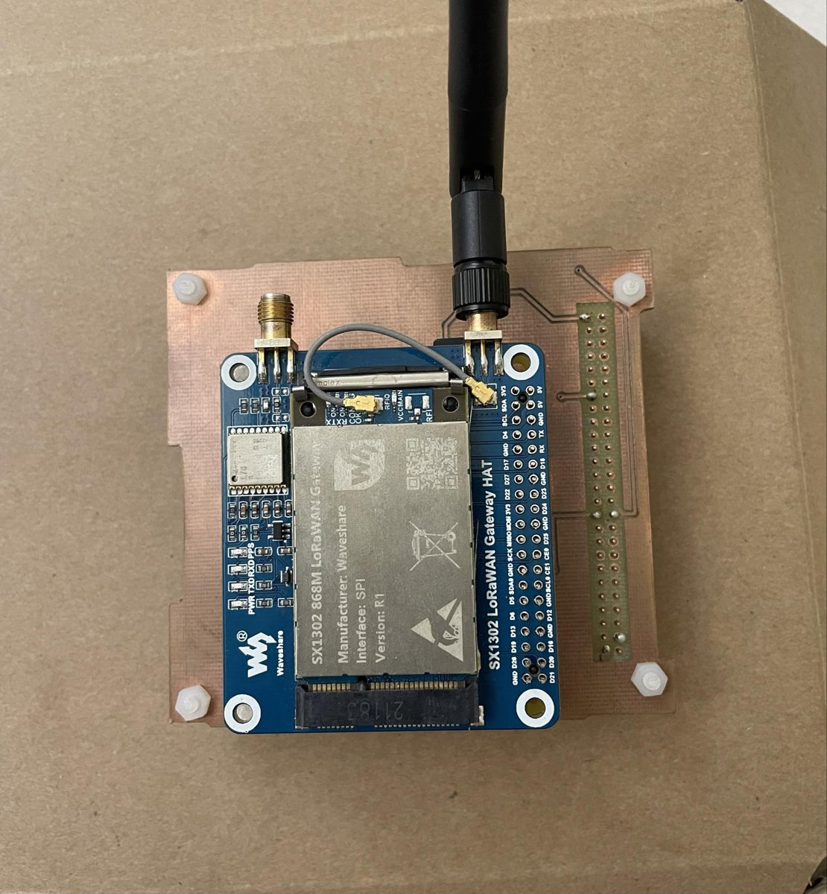
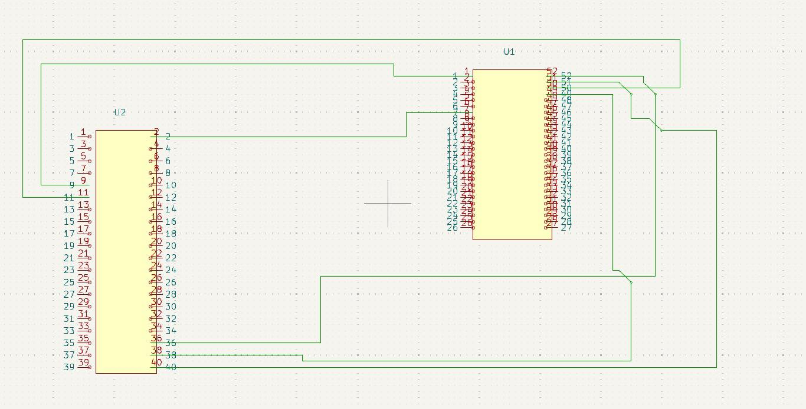
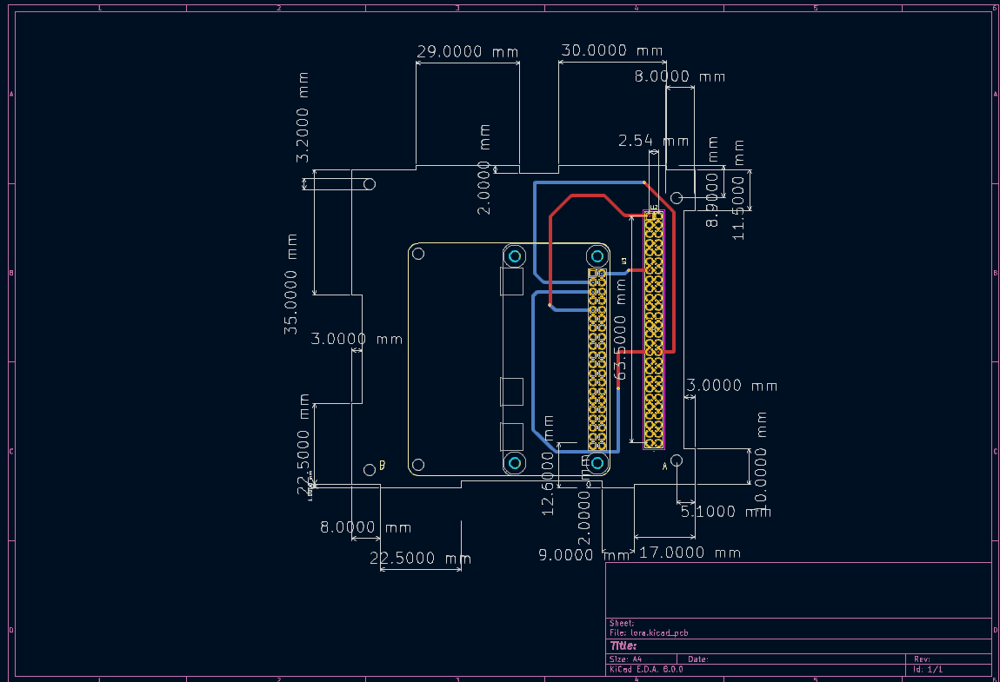
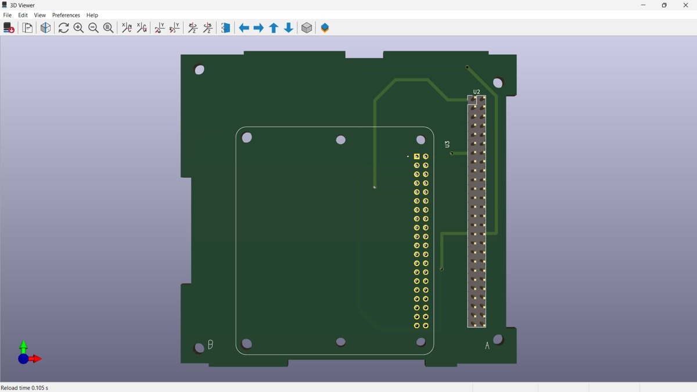
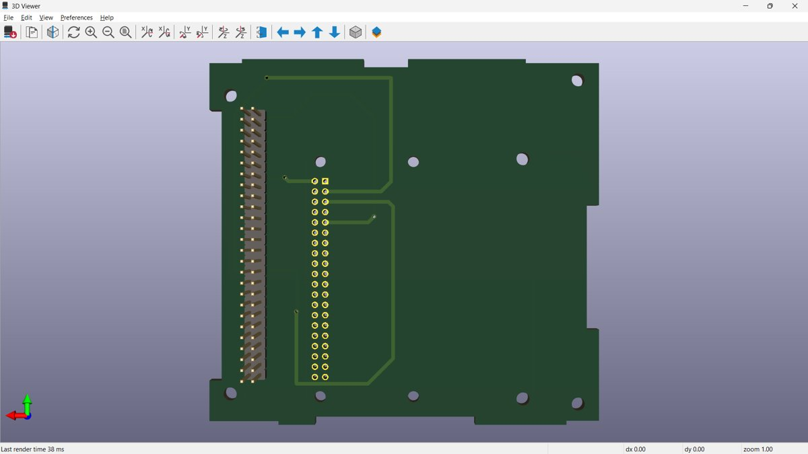

# 🛰️ Carte de communication LoRa pour nanosatellite éducatif (ESAT)

Conception et réalisation d'une **carte de communication LoRaWAN** pour le nanosatellite éducatif **ESAT**. La carte permet au satellite de communiquer à longue distance, avec une faible consommation d'énergie, avec des nœuds IoT au sol.

> Projet de fin d'études (Licence en Ingénierie des Systèmes Informatiques, spécialité Systèmes Embarqués & IoT), Faculté des Sciences de Bizerte, réalisé chez la startup **Tech4IoT** (février à juin 2024).

<p align="center">
  
</p>

---

## 📌 Vue d'ensemble

La carte vient se placer **au-dessus de la carte ADCS** dans la pile de l'ESAT. Elle relie trois éléments :

| Élément | Rôle |
|---|---|
| **Raspberry Pi Zero W** | Hôte de la passerelle, exécute le *Packet Forwarder* et stocke les données localement |
| **Waveshare SX1302 LoRaWAN Gateway HAT (868 MHz)** | Passerelle LoRaWAN (interface SPI avec la Raspberry Pi) |
| **Connecteur ESAT (Samtec SSQ-126-23-G-D, 2×26)** | Liaison avec le bus du satellite. La carte OBC (maître) communique avec la Raspberry Pi en **I²C** |

```
 Nœud IoT au sol  ──LoRa──►  SX1302 HAT  ──SPI──►  Raspberry Pi Zero W  ──I²C──►  OBC (ESAT)
 (B-L072Z-LRWAN1)                                        │
                                                         └──► Cloud LORIOT ──► Application web
```

---

## 🔧 Conception matérielle (KiCad 8)

### Schéma électrique
Le connecteur ESAT (U2) est relié au connecteur 40 broches de la Raspberry Pi Zero (U1). Les lignes **SDA/SCL** du bus I²C et l'alimentation passent par cette liaison.

<p align="center"></p>

### Routage PCB
- Carte **double face** : pistes rouges sur **F.Cu** et bleues sur **B.Cu**, reliées par des vias traversants
- Largeur des pistes : **0,9 mm**, angles à 45° sans angle droit
- Contour et trous de fixation conformes au dessin mécanique de l'ESAT
- Symbole et empreinte du connecteur ESAT et de la Raspberry Pi Zero **créés sur mesure** (`Library_0.pretty/`)
- **ERC** et **DRC** passés sans erreur

<p align="center"></p>

### Visualisation 3D

| Face supérieure | Face inférieure |
|---|---|
|  |  |

### Fabrication
Les fichiers Gerber et de perçage ont été générés pour la **fraiseuse numérique** (dossiers `gerber/` et `final12-03/`).

---

## 💻 Partie logicielle (résumé)

- **Raspberry Pi OS** avec I²C et SPI activés, accès SSH
- **Packet Forwarder SX1302** modifié et **cross-compilé** pour :
  - enregistrer localement les trames reçues (fichier sur la Raspberry Pi)
  - les transmettre à l'OBC et au serveur réseau
- **Nœud final** : STM32 B-L072Z-LRWAN1 (STM32CubeIDE avec l'extension LoRaWAN)
- **Serveur réseau** : LORIOT (WebSocket API)
- **Application web** de visualisation : React.js, Node.js et MySQL (authentification, tableau de bord, alertes par e-mail)

**Validation :** mesure de la température dans les amphithéâtres de la faculté. Les données passent du nœud à la passerelle, puis au stockage local, à LORIOT et au tableau de bord web en temps réel.

---

## 📂 Structure du dépôt

```
├── lora.kicad_pro / .kicad_sch / .kicad_pcb   # Projet KiCad principal
├── New_Symbol_Library_0.kicad_sym            # Symboles personnalisés (ESAT header…)
├── Library_0.pretty/                         # Empreintes personnalisées (ESAT 2x26, Pi Zero…)
├── gerber/ , final12-03/                     # Fichiers de fabrication (Gerber + perçage)
└── images/                                   # Captures pour ce README
```

**Ouvrir le projet :** KiCad 8, puis `File → Open Project → lora.kicad_pro`.

---

## 👥 Équipe

- **Nihed Missar**
- **Nassim Maaoui**

Encadrement : M. Mohamed Ould-Elhassen Aoueileyine (Tech4IoT) et Mme Kaouther Gasmi (FSB).

Dépôt d'origine : [iborntowin/Esat-Pcb-KiCad](https://github.com/iborntowin/Esat-Pcb-KiCad)
